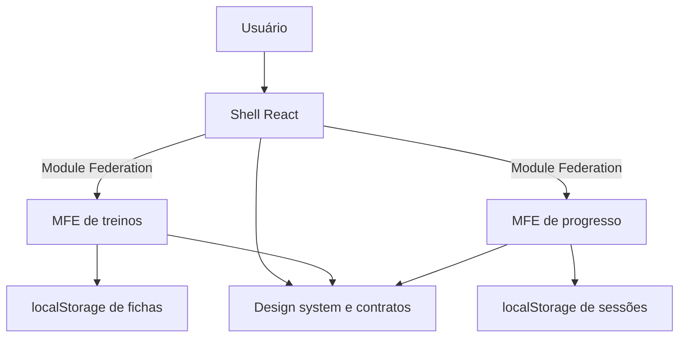
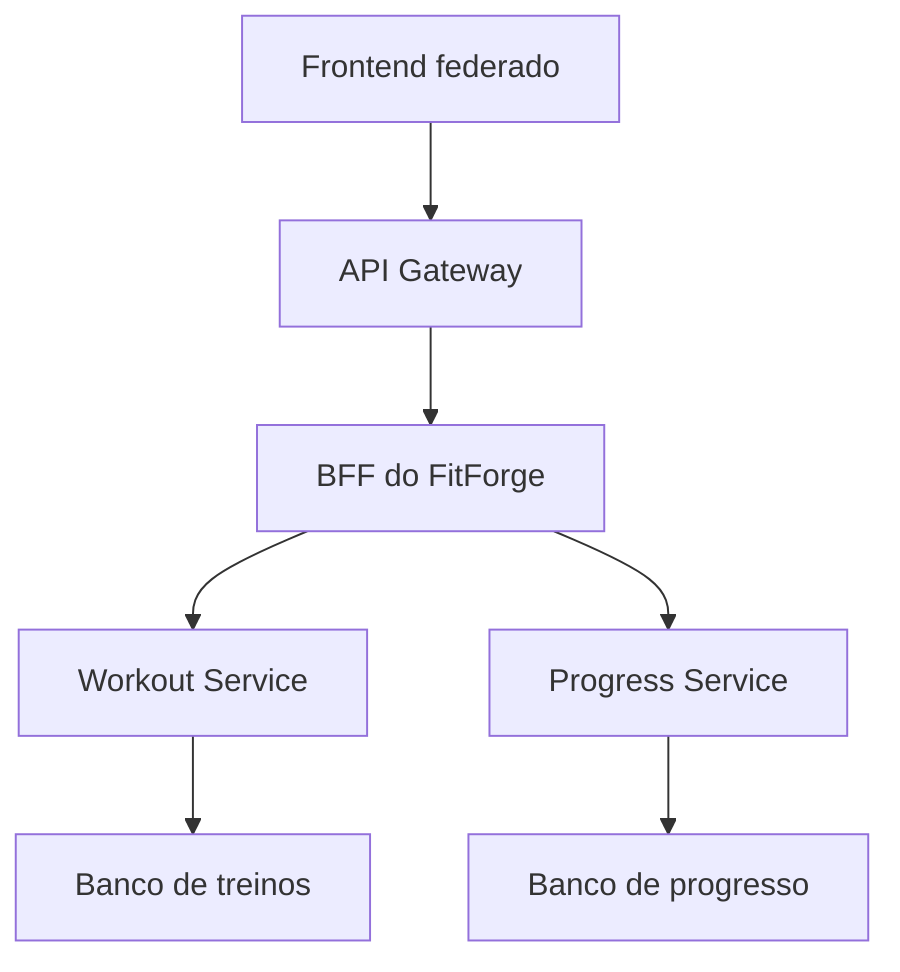

# Arquitetura e decisões

## 1. Limites do projeto

O FitForge implementa o frontend solicitado na **Atividade Formativa 13** do material ASC10. O sistema tem dois domínios de negócio, treinos e progresso, integrados por um shell. Não possui servidor de aplicação, autenticação ou banco remoto nesta versão.

O material ASC12 apresenta a **Atividade Formativa 14**, com microserviços e dois CRUD. As operações CRUD de fichas e sessões aqui são locais ao frontend. Caso essa segunda atividade também seja cobrada, será necessário implementar e publicar APIs de backend.

## 2. Distribuição de responsabilidades



| Unidade | Responsabilidade | Não controla |
| --- | --- | --- |
| Shell | Menu, rotas hash, dashboard, carregamento e orquestração | Escrita direta nos repositórios de negócio |
| Treinos | Fichas, exercícios, validação e armazenamento de fichas | Registros de sessões |
| Progresso | Sessões, histórico, indicadores e exportação | Edição de fichas |
| Shared | Infraestrutura reutilizável, contratos, calendário, UI e CSS | Coleções de dados globais de ambos os módulos |

O pacote `shared` é uma dependência de código compilada nos apps. Ele **não é um quarto remote**. O compartilhamento de React em runtime é feito pela configuração `shared` do ModuleFederationPlugin.

## 3. Builds e exposições

Cada aplicativo possui `package.json`, `webpack.config.cjs`, entrada e bootstrap. `ModuleFederationPlugin` produz `remoteEntry.js` nos remotes. O shell mantém referências remotas e carrega os componentes com `React.lazy` e `Suspense`.

O shell utiliza `./api` para obter os dados agregados do dashboard. São **módulos JavaScript federados**, e não APIs HTTP. O nome `api.js` descreve a interface pública do remote.

```js
// apps/workouts/webpack.config.cjs
exposes: {
  './App': './src/App.jsx',
  './api': './src/api.js'
}

// No shell
const Workouts = lazy(() => import('workouts/App'));
const api = await import('workouts/api');
const fichas = api.listWorkouts();
```

## 4. Dependências e inicialização

- `react` e `react-dom`: singletons, versão exigida 18.3.1, `strictVersion: true`.
- Cada runtime recebe `uniqueName` próprio.
- A entrada assíncrona separa a preparação do compartilhamento da montagem React.
- `publicPath: 'auto'` permite que chunks de remotes usem a URL do próprio script.
- O loader de produção tem timeout de 15 segundos e rejeita falha de download ou container ausente.
- Erros de API federada são tratados separadamente por domínio.
- Erros de renderização/carregamento de componente recebem um `Boundary` por área.
- O shell permanece com navegação disponível quando um remote falha.

**Não remova manualmente os chunks de React do dist dos remotes.** Singletons negociam a instância usada em runtime; os arquivos de fallback ainda são necessários para execução isolada e para cenários de negociação. A estratégia de cópia do PDF pertence ao plugin Vite utilizado naquele exemplo e não deve ser transferida literalmente ao Webpack.

## 5. Comunicação entre módulos

O shell é o mediador. Progresso recebe `workouts` como prop somente para escolher uma ficha, e não importa o código interno do MFE de treinos.

1. O usuário escolhe “Registrar sessão” em uma ficha.
2. O MFE de treinos chama a prop `onStart(workoutId)`.
3. O shell muda para a rota de progresso.
4. O shell passa `initialWorkoutId` ao MFE de progresso.
5. Progresso abre o formulário com a ficha selecionada e avisa que consumiu o comando.
6. Ao salvar, o repositório de progresso dispara `fitforge:sessions-updated`.
7. O shell relê a API pública de sessões e atualiza os indicadores.

### Contrato de eventos

| Evento | Emissor | Consumidores | Payload |
| --- | --- | --- | --- |
| `fitforge:workouts-updated` | Repositório de treinos | Treinos e shell | Sem payload; reler a fonte do domínio |
| `fitforge:sessions-updated` | Repositório de progresso | Progresso e shell | Sem payload; reler a fonte do domínio |
| `storage` | Navegador, em outras abas da mesma origem | Shell e respectivos módulos | Chave alterada fornecida pelo navegador |

Os eventos são invalidações de cache de leitura. O estado não é duplicado no payload, reduzindo o risco de consumidores receberem uma coleção antiga.

## 6. Modelo de dados

### Ficha

```json
{
  "id": "uuid",
  "name": "Treino A",
  "description": "Superior",
  "days": ["Seg", "Qui"],
  "exercises": [
    {
      "id": "uuid",
      "name": "Supino reto",
      "muscle": "Peito",
      "sets": 3,
      "reps": 12,
      "load": 20,
      "rest": 90
    }
  ]
}
```

### Sessão

```json
{
  "id": "uuid",
  "workoutId": "uuid-da-ficha",
  "workoutName": "Treino A",
  "date": "2026-10-09",
  "duration": 45,
  "effort": 7,
  "bodyWeight": null,
  "notes": "Concluído"
}
```

`workoutName` é um snapshot histórico. Excluir ou renomear a ficha não reescreve silenciosamente sessões antigas. Editar uma sessão que ainda possui ficha atualiza o nome para o da ficha selecionada; editar uma sessão cuja ficha foi excluída preserva seu nome histórico.

As coleções são persistidas como `{ "version": 1, "items": [...] }`. A versão permite introduzir migração explícita no futuro. Hoje versões diferentes são rejeitadas sem sobrescrever o conteúdo.

## 7. Persistência e consistência

A leitura valida estrutura, campos e identificadores. A escrita valida a coleção inteira e só dispara o evento depois que `localStorage.setItem` retorna com sucesso. Em falha de quota, a interface não informa sucesso.

Os dois repositórios compartilham a mesma infraestrutura, mas usam chaves separadas e validadores próprios. Essa separação é **ownership de estado no frontend**, não o padrão Database per Service descrito no ASC11.

O localStorage não fornece transações entre abas. Atualizações concorrentes exatamente ao mesmo tempo podem sobrescrever uma à outra. O evento `storage` mantém a interface sincronizada, mas não resolve concorrência multiusuário. Isso deve ser tratado no futuro backend.

## 8. Deploy unificado e independente

`npm run build` compila os remotes, compila o shell e copia os artefatos completos para a pasta de publicação. O domínio único simplifica a atividade acadêmica e evita configuração entre origens.

Os builds continuam distintos e federados em runtime, mesmo dentro de um único pacote de publicação. O workflow fornecido publica o conjunto.

Para deploy independente, publique um remote completo em sua pasta correspondente, preservando a interface `./App`, `./api` e a versão de React compatível. Para hospedagens separadas, ajuste o loader do shell para URLs HTTPS fixas/configuráveis e valide os cabeçalhos necessários dos recursos servidos. Não use URLs localhost em produção.

Ao atualizar um remote, envie os novos chunks **antes** de substituir `remoteEntry.js`, preserve por um período os chunks antigos e invalide/revalide o manifest. Um usuário com a versão anterior aberta ainda pode solicitar chunks antigos.

## 9. Relação com os PDFs

| Material | Conceito aproveitado | Aplicação concreta |
| --- | --- | --- |
| ASC10-MICROFRONTEND | Domínios independentes | Treinos e progresso em aplicativos próprios |
| ASC10-MICROFRONTEND | Module Federation em runtime | Host consumindo dois remoteEntry.js |
| ASC10-MICROFRONTEND | Consistência visual e dependências | Design system e React singleton |
| ASC10-MICROFRONTEND | Build unificado para Azure | Script assemble copiando artefatos ao dist |
| ASC12-Microservices | Responsabilidade e isolamento | Limites de domínio e falha isolada no frontend |
| ASC11-Microservices + Database per Service + API Gateway + BFF | Independência de dados e agregação | Orientação para evolução futura, descrita abaixo |

## 10. Evolução para backend

Para a atividade de microserviços, uma possível evolução é:

- **Workout Service**: CRUD de fichas e exercícios com banco próprio.
- **Progress Service**: CRUD de sessões com banco próprio e snapshots dos nomes das fichas.
- **API Gateway**: ponto de entrada HTTP com roteamento e autenticação.
- **BFF**: endpoints moldados à interface, agregando o dashboard sem exigir várias chamadas do navegador.



Essa camada **não está implementada**. Os repositórios locais são o ponto de adaptação para adicionar `fetch`, tratamento HTTP e autenticação. Static Web Apps ou Storage hospedam o frontend; microserviços precisariam de hospedagem de backend própria. O BFF não deve ser confundido com o shell: um roda no servidor e o outro organiza a interface no navegador.
